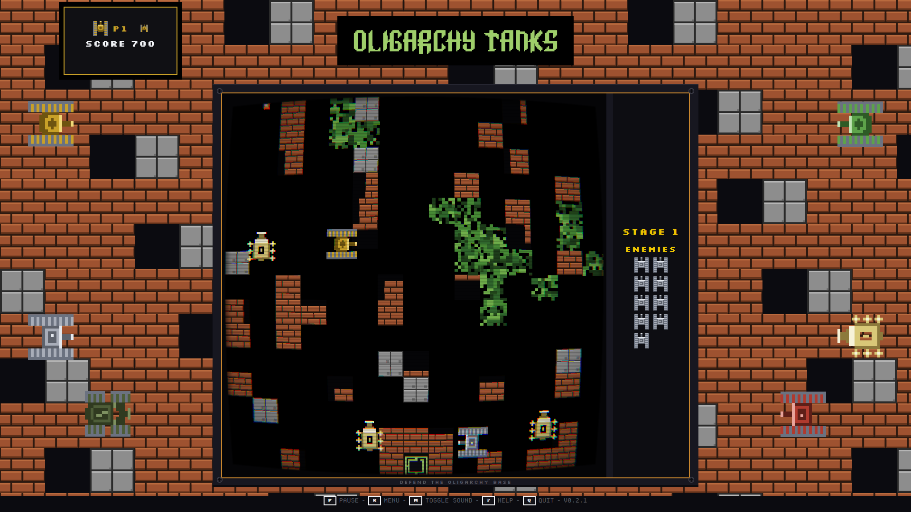
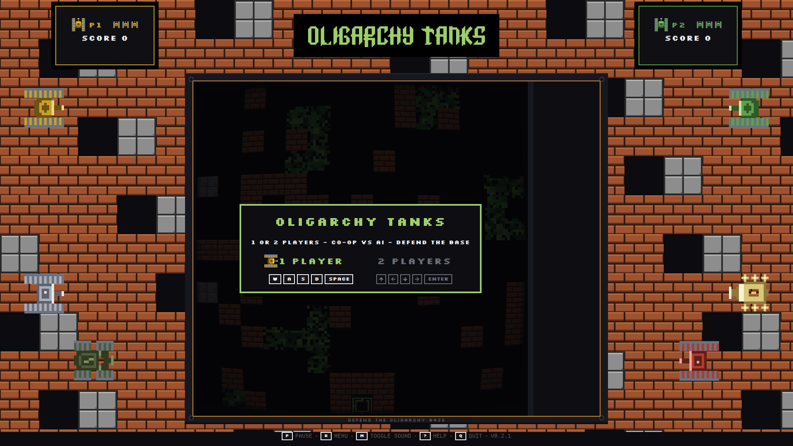
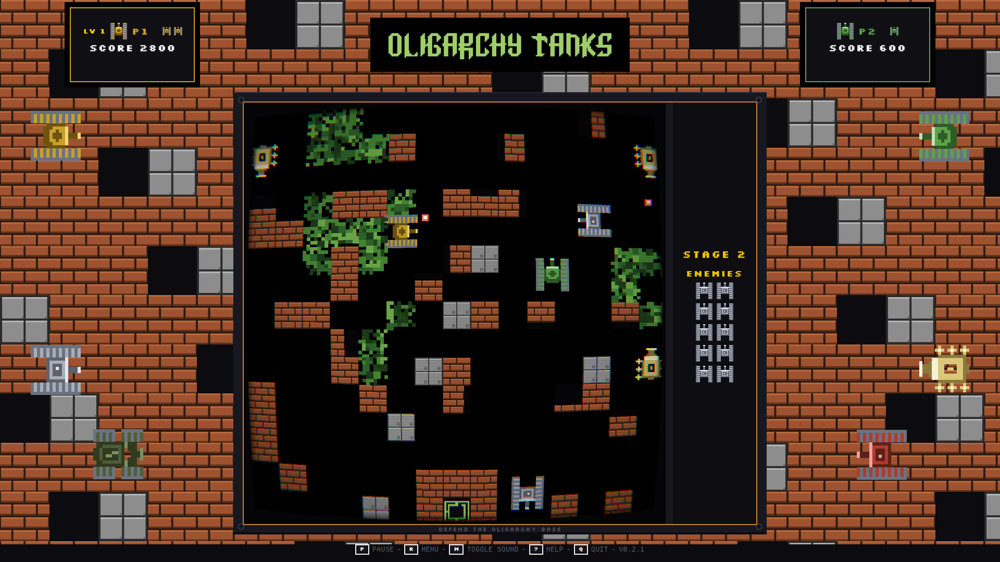

# Oligarchy Tanks

Retro local tank battle vs AI, in the style of classic Battle City on Sega.

Defend the star base alone or with a friend. 16 enemies per sector, random map
every game.

<p align="center">
  
</p>

<p align="center">
  
  
</p>

## Install

On Arch and Omarchy:

```sh
omarchy pkg add oligarchy-tanks
```

Or from the AUR, once the package is published:

```sh
yay -S oligarchy-tanks
```

Building from source needs Qt 6 (`qt6-base`, `qt6-declarative`,
`qt6-multimedia`):

```sh
bin/build
./build/oligarchy-tanks
```

## Start

The game opens on the arcade select screen: **1 PLAYER** or **2 PLAYERS**.

- `Left` / `Right` (or `A` / `D`, or the pad's stick and d-pad) move the
  highlight.
- `Space` / `Enter`, `START` on a pad, or a click confirms it.

Each mode shows its own keys under its name, drawn as key caps: player 1 on
`W A S D` and `Space`, player 2 on the arrows and `Enter`. With a pad plugged
in, a row of pad pictures appears below them (`L2` / `R2` / `X` to fire).

In a **one-player game there is a single tank**: when it runs out of lives the
run is over. Either way the run ends on a **`GAME OVER`** screen with the score
(`BASE DESTROYED` if the base was lost), and `START`, `Space` or `Enter` carries
on to the select screen with the last mode still highlighted.

`R` during a game also returns to the select screen; on `victory` it goes
straight to the next sector.

## Controls

| Key | Action |
|-----|--------|
| P1 `W A S D` | Move player 1 |
| `Space` | Fire player 1 |
| P2 Arrow keys | Move player 2 |
| `Enter` | Fire player 2 |
| `P` | Pause / resume |
| `R` | Back to the select screen (next sector on `victory`) |
| `M` | Sound on / off |
| `?` | Help overlay |
| `Q` | Quit |

## Gamepad

A DualSense or Xbox pad works out of the box: it is read straight from
`/dev/input`, with no extra software. **The keyboard always stays live for both
players**, so a pad never takes a tank away from anyone.

| Pad | Action |
|-----|--------|
| `START` | Confirm the mode on the select screen, join a tank, pause and resume |
| Left stick / d-pad | Move (and pick the mode on the select screen) |
| `L2` / `R2`, or `Square` (PlayStation) / `X` (Xbox) | Fire (and confirm the mode) |
| `SHARE` / `SELECT` | Menu, like `R` (back from a run, next sector on victory) |

Each tank shows the device driving it (`KEY` or `PAD n`) and, underneath,
a blinking hint with the keys that drive it (`Space`; `Enter` for player 2;
`START` too while a pad is around), drawn as key caps. The hint is only an
invitation: it goes away as soon as that player uses a control, and it never
blocks anything.

On the select screen any pad drives the choice, even one that just played a
run: stick or d-pad moves the highlight, `START` (or `Square` / `X`) confirms it.
Starting a new game hands every pad back to waiting, so which tank a pad gets is
always decided by the mode and by who presses `START`, never carried over from
the run before.

Joining is by `START`:

- **One player** — the keyboard drives the tank (or `Space`); a pad takes it
  over as soon as it presses `START`.
- **Two players** — player 1 keeps the keyboard, the **first** pad to press
  `START` takes player 2 and a second pad takes player 1, so one pad means one
  human on it.

Unplugging a pad hands its tank back to the keyboard and the hint comes back;
plug it in again and press `START` to rejoin (it may come back with a different
pad number).

Reading `/dev/input/event*` requires being in the `input` group. Most desktop
installs already are; if pads are not detected, check with `id -nG`. Without the
group, or with no pad plugged in, the game simply runs on the keyboard as
before. To diagnose a pad that does not work, run `OLIGARCHY_TANKS_PAD_DEBUG=1 ./build/oligarchy-tanks`
and watch the `[pad]` lines.

## Rumble

DualSense pads vibrate with the game's own sounds (shoots, hits,
explosions, power-ups) over hidraw, on USB. Bluetooth pads and Xbox
pads are out of scope for now. Sound and vibration are separate
switches: `M` toggles the sound only, `V` toggles the pad vibration
only — the footer keeps an icon for each. To disable rumble entirely,
run `OLIGARCHY_TANKS_RUMBLE=0 ./build/oligarchy-tanks`.

## Build

```
bin/build
./build/oligarchy-tanks
bin/test
bin/install
```

## Other platforms

The game is a plain Qt 6 app: everything it needs (fonts, sounds, the engine)
ships inside the binary, and the desktop theme has a hard-coded fallback, so it
runs wherever Qt 6 runs:

- **Windows / macOS**: build with `qmake6 oligarchy-tanks.pro && make` (plus
  `windeployqt` / `macdeployqt` to bundle the Qt libraries), then run
  `build/oligarchy-tanks`. Both players share one keyboard (`W A S D` +
  `Space`, arrows + `Enter`) — the intended 2-player setup.
- The **gamepad reader is Linux only** (it reads `/dev/input` directly), so
  outside Linux pads are not supported; the game falls back to the keyboard
  with no other change.
- There is no WebAssembly build (Qt multimedia and pad input do not fit it).

## Development

Architecture notes, the state of the build and the handover for the next
contributor live in [`AGENTS.md`](AGENTS.md).

## Credits

The UI is set in [Silkscreen](https://github.com/googlefonts/silkscreen) by
Jason Kottke, bundled under the SIL Open Font License (see
`src/fonts/OFL.txt`). Descriptive text in the manual uses
[Departure Mono](https://departuremono.com/) by Helena Zhang, also SIL OFL
(see `src/fonts/OFL-DepartureMono.txt`). The game's marquee is set in
[Omarchy Font](https://github.com/markcuda/Omarchy-Font) by Mark Cuda, a
pixel recreation of the official Omarchy wordmark, bundled under the MIT
license (see `src/fonts/OmarchyFont-LICENSE.txt`).

The 8-bit sound set is original project material — no third-party samples.
Some sounds were synthesised specifically for the game, and the rest was
produced by hand in FL Studio Mobile ("the explosions are ours too").
